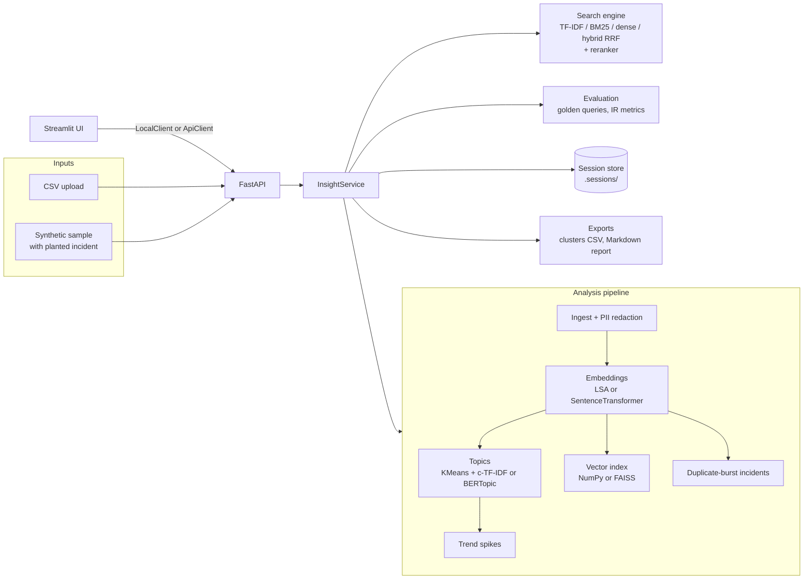

# SignalSift

**Find what's breaking in your support queue.** SignalSift turns a pile of unstructured support
tickets into topics, a searchable history, trend spikes and incident alerts, and it measures how
well its own search works.

FastAPI backend · Streamlit UI · pluggable embedders, vector stores and rerankers · 78 tests ·
CI on Python 3.10–3.12 · runs fully offline by default.

---

## At a glance

**Problem.** Tickets pile up without structure. Product teams lose sight of what is breaking, for
whom, and how fast it is growing. A release that crashes the app shows up as fifty slightly
different complaints in two hours, and nobody connects them until the next day.

**What it does.**

| Capability | How |
|---|---|
| PII redaction | Emails, phones, cards, IPs, URLs and @handles are replaced with placeholders *before* anything is embedded or stored |
| Topic discovery | KMeans on embeddings with silhouette-based auto *k*, labelled with class-based TF-IDF keywords (BERTopic-style). Real BERTopic is one setting away |
| Semantic search | TF-IDF baseline, BM25, dense retrieval and **hybrid BM25 + dense via reciprocal rank fusion**, with an optional reranking stage |
| Trend spikes | Per-topic volume against a trailing baseline, with a Poisson floor so quiet topics don't fire on one extra ticket |
| Incident detection | Near-duplicate groups, then the densest time window in each, flagged when it is far above that group's normal rate; paraphrase groups are merged |
| Evaluation | Recall@k, Precision@k, nDCG@k, MRR@k and HitRate@k for every retriever on golden queries, with per-query error analysis |
| Exports | Clusters CSV and a Markdown executive report |

**Engineering practices.** Decoupled API and UI (the UI talks to a `Client` interface with an
in-process and an HTTP implementation, tested for parity) · env-driven config with Pydantic ·
persistent file-backed sessions with path-traversal-safe ids · synthetic data with planted ground
truth so every stage is testable · ruff + mypy + pytest in CI · Docker Compose.

---

## Architecture



The Streamlit UI holds no logic. Every action goes through `signalsift.client.Client`:

- `LocalClient` runs the service in-process. This is the default, and what Hugging Face Spaces uses.
- `ApiClient` calls the FastAPI backend over HTTP. Docker Compose uses this.

Both return identical JSON, and `tests/test_client.py` runs the same flow through each.

---

## Quickstart

Requires Python 3.10+.

```bash
python -m venv .venv && source .venv/bin/activate     # Windows: .venv\Scripts\activate
pip install -e ".[dev]"

streamlit run app.py          # UI on http://localhost:8501
```

Click **Analyze sample dataset** in the sidebar. It generates 3,000 tickets and analyses them in a
few seconds, with no downloads and no GPU.

### Run the API and UI separately

```bash
make api                      # FastAPI on :8000, interactive docs at http://localhost:8000/docs
make dev                      # Streamlit in API mode (second terminal)
```

### Docker

```bash
docker compose up --build     # API on :8000, UI on :8501, sessions in a named volume
```

### Pretrained models (optional)

The default stack (LSA embeddings and a heuristic reranker) is chosen so the project runs anywhere,
including CI. For real data you will want pretrained models:

```bash
pip install -e ".[dev,ml]"    # sentence-transformers, BERTopic, FAISS
export SIGNALSIFT_EMBEDDER=sbert
export SIGNALSIFT_RERANKER=cross-encoder
export SIGNALSIFT_VECTOR_BACKEND=faiss
export SIGNALSIFT_CLUSTER_METHOD=bertopic
streamlit run app.py
```

### Hugging Face Spaces

The YAML header at the top of this README is the Spaces config. Push the repo to a Streamlit
Space and it runs `app.py` with `requirements.txt`.

---

## Using your own data

Upload any CSV with one ticket per row. Columns are auto-detected and can be overridden.

| Purpose | Auto-detected names | Required |
|---|---|---|
| Ticket text | `text`, `body`, `message`, `description`, `ticket`, `content`, `comment`, `feedback` | Yes |
| Timestamp | `created_at`, `timestamp`, `date`, `time`, `created`, `datetime` | For trends and incident windows |
| Id | `id`, `ticket_id`, `tweet_id`, `message_id` | No (generated if absent) |

Any other column (channel, product, tier) is carried through to the clusters export.

**Golden queries for evaluation** are JSON. Relevance is given either as ticket ids, or as labels
matched against a column (default `intent`):

```json
[
  {"query": "charged twice for one order", "relevant_ids": ["TCK-00012", "TCK-00488"]},
  {"query": "app crashes after update", "relevant_labels": ["crash_after_update"]}
]
```

```bash
python scripts/run_eval.py --csv my_tickets.csv --golden golden.json --text-col body
```

---

## Configuration

Every setting is an environment variable with the prefix `SIGNALSIFT_`, or a line in `.env`
(see `.env.example`).

| Variable | Default | Meaning |
|---|---|---|
| `EMBEDDER` | `lsa` | `lsa` (TF-IDF + SVD fitted on your corpus) or `sbert` |
| `SBERT_MODEL` | `all-MiniLM-L6-v2` | Any SentenceTransformer model |
| `RERANKER` | `heuristic` | `none`, `heuristic` or `cross-encoder` |
| `VECTOR_BACKEND` | `numpy` | `numpy` (exact) or `faiss` |
| `CLUSTER_METHOD` | `kmeans` | `kmeans` or `bertopic` |
| `N_TOPICS` | `0` | `0` picks *k* by silhouette score |
| `TREND_FREQ` | `D` | Bucket size: `h`, `D` or `W` |
| `SPIKE_Z` | `3.0` | z-score needed to flag a spike |
| `DUPLICATE_THRESHOLD` | `0.85` | Cosine similarity for two tickets to count as near-duplicates |
| `INCIDENT_MIN_SIZE` | `8` | Minimum tickets in the burst window |
| `INCIDENT_WINDOW_HOURS` | `48` | Burst window length |
| `INCIDENT_BURST_RATIO` | `4.0` | How much denser than normal the window must be |
| `REDACT_PII` | `true` | Redact before embedding |
| `MAX_ROWS` | `50000` | Rows kept per upload |
| `SESSION_DIR` | `.sessions` | Where analyses are persisted |
| `UI_MODE` | `local` | `local` or `api` |
| `API_URL` | `http://localhost:8000` | Used when `UI_MODE=api` |

---

## API

Full interactive docs are at `/docs` once the API is running.

| Method | Path | Purpose |
|---|---|---|
| `GET` | `/health` | Liveness and active embedder |
| `POST` | `/sessions` | Upload a CSV (multipart: `file`, optional `name`, `text_col`, `time_col`, `n_topics`) |
| `POST` | `/sessions/sample` | Analyse the synthetic dataset (`{"n": 3000}`) |
| `GET` | `/sessions` | List saved analyses |
| `GET` / `DELETE` | `/sessions/{id}` | Summary and ingestion report, or delete |
| `GET` | `/sessions/{id}/topics` | Topics with keywords and representative tickets |
| `GET` | `/sessions/{id}/topics/{topic}/tickets` | Tickets in one topic |
| `GET` | `/sessions/{id}/trends` | Volume series and spikes |
| `GET` | `/sessions/{id}/incidents` | Duplicate-burst incidents |
| `POST` | `/sessions/{id}/search` | `{"query", "k", "mode": "tfidf|bm25|dense|hybrid", "rerank"}` |
| `POST` | `/sessions/{id}/evaluate` | Golden queries (optional on labelled data) |
| `GET` | `/sessions/{id}/export/clusters.csv` | Every ticket with its topic |
| `GET` | `/sessions/{id}/export/report.md` | Executive report |

```bash
SID=$(curl -s -X POST localhost:8000/sessions -F file=@data/sample_tickets.csv | jq -r .session_id)
curl -s -X POST localhost:8000/sessions/$SID/search \
     -H 'content-type: application/json' \
     -d '{"query": "app crashes after the update", "k": 5}' | jq '.[].text'
curl -s localhost:8000/sessions/$SID/incidents | jq '.[0] | {size, start, end, sample_text}'
```

Errors are consistent: unknown sessions return 404, bad input returns 422 with a message, and
oversized uploads return 413.

---

## How it works

**Ingestion.** Text is whitespace-normalised, rows under three characters are dropped and
timestamps are parsed leniently (unparseable values become missing, not errors). PII is redacted
with ordered regexes, so emails are removed before @handles and IPs before phone numbers. The
ingestion report counts each kind of redaction.

**Embeddings.** The default `LSAEmbedder` fits TF-IDF (1–2 grams) and truncated SVD on your
corpus, then L2-normalises. Support-chat filler ("thanks", "pls help") and redaction placeholders
are stop words, which raised clustering agreement with the true intents (adjusted Rand index)
from 0.27 to 0.36 on the sample data. `SentenceTransformerEmbedder` is a drop-in replacement.

**Topics.** The number of clusters is chosen by cosine silhouette on a sample. Clusters are
renumbered by size and labelled with class-based TF-IDF: each cluster is treated as one document,
so keywords are the terms that distinguish it from the others, not merely the most common ones.

**Search.** Four first-stage retrievers share one engine. Hybrid mode fuses BM25 and dense
rankings with reciprocal rank fusion, which needs no score calibration between the two. The
reranker rescores the top 50 candidates. The cross-encoder reads the query and ticket together;
the heuristic reranker blends first-stage scores with query-term coverage and is a no-download
stand-in, not a learned model.

**Trend spikes.** Ticket counts per topic and period are compared with the trailing seven-period
mean. The denominator is `max(rolling std, sqrt(baseline))`, a Poisson floor that stops a topic
going from 0 to 2 tickets from scoring z = ∞.

**Incidents.** Tickets are linked when their cosine similarity passes the threshold, and connected
components become near-duplicate groups (computed in chunks, so memory stays bounded). Inside each
group, a two-pointer sweep finds the densest window. The window is an incident when it holds at
least `INCIDENT_MIN_SIZE` tickets and is `INCIDENT_BURST_RATIO` times denser than the group's rate
*outside* the window. A complaint that never existed before therefore always qualifies, while a
perennial complaint does not fire just because it is common. Bursts that overlap in time and are
similar or share a topic are merged, because paraphrases of the same failure often land in
separate duplicate groups.

**Sessions.** Each analysis is saved as a pickle plus a JSON metadata file, written atomically.
Ids must match `^[a-f0-9]{12}$`, so a crafted id cannot escape the directory. The search engine is
rebuilt on load rather than pickled, because FAISS indexes cannot be pickled and model weights
should not be.

---

## Evaluation

Results on the bundled synthetic dataset (3,000 tickets, 22 intents, 25 golden queries, k = 10),
using the default offline stack. Reproduce with `make eval`.

| System | Recall@10 | Precision@10 | nDCG@10 | MRR@10 | HitRate@10 |
|---|---|---|---|---|---|
| TF-IDF baseline | 0.940 | 0.940 | 0.946 | 0.960 | 0.96 |
| BM25 | 0.936 | 0.936 | 0.943 | 0.965 | 1.00 |
| Dense (LSA) | 0.908 | 0.908 | 0.905 | 0.900 | 0.92 |
| Hybrid (RRF) | 0.940 | 0.940 | 0.944 | 0.960 | 0.96 |
| **Hybrid + rerank** | **0.952** | **0.952** | **0.955** | 0.960 | 0.96 |

How to read this honestly:

- **The synthetic data is easy for keyword methods.** Tickets are generated from templates, and
  several golden queries share words with them, so TF-IDF and BM25 already score highly. These
  numbers show the evaluation framework works end to end; they are not a claim about real-world
  quality.
- **LSA alone is the weakest retriever here.** It is fitted on 3,000 short texts, so it cannot
  learn much semantics. Fusing it with BM25 recovers the loss, and reranking adds a little more.
- **Recall@k is capped**: `hits / min(k, |relevant|)`, as in BEIR. One intent can have hundreds of
  relevant tickets, and uncapped recall@10 would be near zero for every system.
- **Use the per-query view.** "package has not arrived after the expected date" fails for every
  system because the tickets say "overdue", "tracking stuck" and "late". That is the vocabulary
  gap a pretrained bi-encoder (`SIGNALSIFT_EMBEDDER=sbert`) is meant to close.

To measure on real data, run `scripts/run_eval.py` with your own CSV and golden set, ideally with
the `ml` extra installed so dense retrieval uses a pretrained model.

### Incident detection on the sample

The generator plants 75 near-identical "app crashes after updating to 4.2.0" tickets inside 30
hours, plus a three-day rise in declined payments. With default settings the largest incident
found is that crash burst (74 tickets, all from the planted intent), and the declined-payment
rise is caught as both spikes and smaller bursts. `tests/test_clustering_trends.py` asserts the
top incident is over 90% pure and fits inside the 48-hour window.

---

## Project structure

```
signalsift/
├── app.py                      Streamlit entry point (also Hugging Face Spaces)
├── signalsift/
│   ├── config.py               Pydantic settings (SIGNALSIFT_*)
│   ├── pii.py                  Regex PII redaction
│   ├── ingest.py               CSV normalisation and column detection
│   ├── embeddings.py           LSA and SentenceTransformer embedders
│   ├── index.py                NumPy and FAISS vector indexes
│   ├── lexical.py              BM25
│   ├── rerank.py               Heuristic and cross-encoder rerankers
│   ├── search.py               Retrievers, reciprocal rank fusion, reranking
│   ├── clustering.py           Auto-k KMeans, c-TF-IDF labels, BERTopic adapter
│   ├── trends.py               Topic volume, spikes, duplicate-burst incidents
│   ├── evaluation.py           IR metrics and evaluation runner
│   ├── pipeline.py             Ingest → embed → topics → trends → incidents
│   ├── report.py               Markdown executive report
│   ├── sessions.py             Atomic, traversal-safe session store
│   ├── service.py              Use cases shared by API and UI
│   ├── client.py               LocalClient and ApiClient
│   ├── datasets.py             Synthetic tickets with planted ground truth
│   ├── text.py                 Shared stop words
│   └── api/main.py             FastAPI app factory and routes
├── ui/streamlit_app.py         Six-tab UI
├── scripts/                    Sample data generation and CLI evaluation
├── data/                       Sample tickets and golden queries
├── tests/                      78 tests: units, API, client parity, headless UI
├── .github/workflows/ci.yml    ruff, mypy, pytest on 3.10–3.12, eval artifact
├── Dockerfile, docker-compose.yml, Makefile, .env.example
```

---

## Testing and CI

```bash
make check        # ruff + mypy + pytest with coverage
make eval         # writes reports/eval_summary.md, eval_per_query.csv, report.md
```

The suite covers each module in isolation, the full API with FastAPI's `TestClient`, both UI
transports running the same flow, and a headless run of the Streamlit app using `AppTest`.
Statement coverage of the `signalsift` package is above 95%; the uncovered lines are the optional
model-download paths. CI runs on Python 3.10, 3.11 and 3.12 and uploads the evaluation report as
a build artifact.

---

## Changes from InsightMiner

This project started from the InsightMiner design and was renamed and reworked.

**Added**

- Hybrid retrieval (BM25 + dense via reciprocal rank fusion) and a standalone BM25 retriever
- An offline default stack, so the app and CI need no model downloads
- Incident detection based on rate outside the burst window, plus merging of paraphrase bursts
- A synthetic dataset with planted incidents and spikes, so detection is tested against truth
- Precision@k in the evaluation
- `Client` abstraction with an in-process mode, so one container can serve the UI
- Docker Compose, a Makefile and a headless UI test

**Removed**

- Fine-tuning SentenceTransformers on domain data. It needs labelled pairs and a GPU to be
  meaningful, and it was the hardest part to test in CI. See the roadmap.
- The bundled Twitter customer-support evaluation. Shipping a slice of third-party social media
  data raises size and terms-of-use questions, so the bundled evaluation runs on synthetic data;
  `scripts/run_eval.py` runs the same evaluation on any CSV you have the rights to use.

---

## Limitations and roadmap

- LSA cannot connect lexically different paraphrases. Use `sbert` for real data.
- KMeans assigns every ticket to a topic; BERTopic mode adds an outlier topic for noise.
- Sessions are pickles. That is fine for a single-tenant tool reading files it wrote, but a
  multi-user deployment should move to Parquet plus a vector database.
- Incident detection compares all pairs in chunks, so it is O(n²) in time. For more than about
  50,000 tickets, use approximate neighbours (FAISS IVF or HNSW) or limit pairs to a time window.

Roadmap: contrastive fine-tuning from resolved-ticket pairs, LLM-written topic names and incident
summaries, streaming ingestion from Zendesk or Intercom, and alerting through Slack webhooks.

---

## License

MIT
